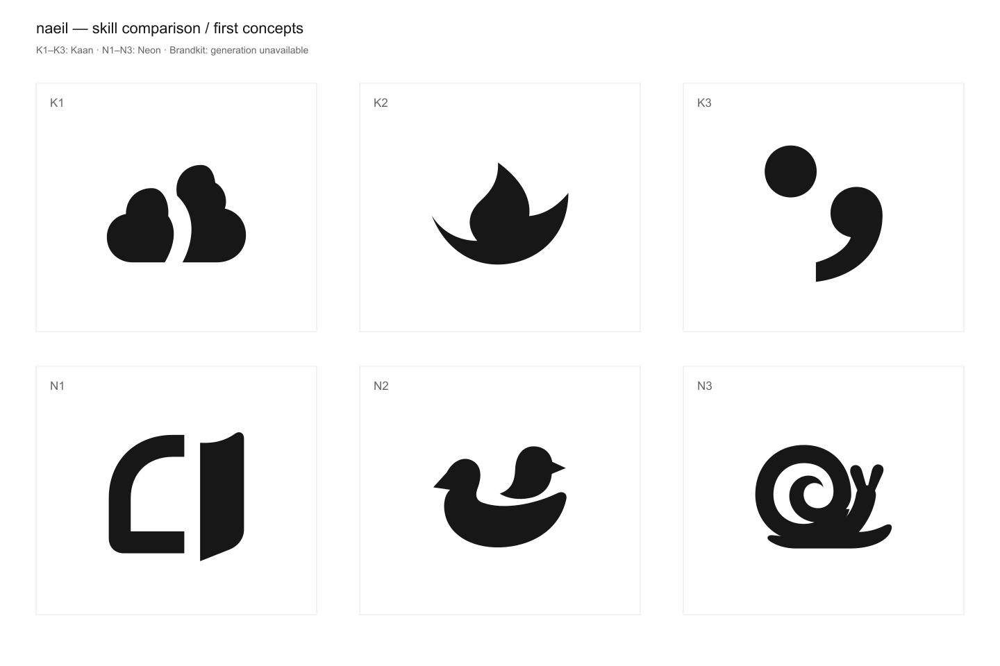

# naeil — 외부 스킬 실제 적용 비교

2026-10-10. 사용자가 이미 정한 브리프를 그대로 사용해 외부 스킬의 결과를 비교하는 첫 실행이다. 스킬 제작/개정이나 제품 로고 교체가 아니다.

[형태 비교 이미지](comparison.png) · [설명을 펼칠 수 있는 비교 화면](index.html) · [공통 브리프](brief.md)

## 실행 결과

| 스킬 | 실제 실행한 과정 | 산출물 | 이번 결과의 판단 |
|---|---|---|---|
| Kaan logo-design | 원문·관련 지침 읽기 → 연상/상투성 정리 → 12개 발상 상대 선별 → SVG3개와 러프 비교 → 일부 재작성 → 렌더/감사 | [3안 보드](kaan/concepts.png), [러프18개](kaan/sketches.png), [과정 기록](kaan/process.md), SVG, 예비 검증 시트 | 선별 근거는 자세해졌지만 심벌의 고유성과 장면 판독은 충분히 좋아지지 않았다 |
| Neon logo-designer | 공통 브리프 → 원문 요구대로 개별 콘셉트 병렬 제작 → 각 제작자가 렌더 확인 → 후보2개 한 차례 수정 → 비교 | [3안 비교](neon/preview.html), SVG, 개별 해석·관찰 기록 | 새와 달팽이의 관계/행동이 더 읽히지만 익숙한 픽토그램을 벗어나지는 못했다 |
| Leonxlnx brandkit | 원문 읽기 → 전략/메타포 결정 → 허용된 2×2 concept board 프롬프트 → 내장 이미지 생성 호출 | [실제 프롬프트](brandkit/prompt.txt), [오류 기록](brandkit/STATUS.md) | HTTP405로 생성 실패. 결과 없음. 품질 비교에서 제외 |

Kaan의 18개 러프는 여섯 발상 안의 형태 연구이며 독립적인 콘셉트18개가 아니다. 최초 작은 시트가 비례·기울기 변경에 치우쳐 있었기 때문에 최종 세 후보의 관찰 뒤에 일부 러프를 다시 펼쳐 그림으로써 빈틈/배치/구조를 비교했다. 엄격한 ‘모든 러프 완성 후 최종 후보 선택’의 순서는 아니었다. 이 차이를 스킬의 효과로 오인하면 안 된다.

## 의미와 실제로 보이는 것

| 후보 | 의도한 의미 | 실제 형태에서 보이는 것 | 예상 감정과 다른 해석 | 판단 |
|---|---|---|---|---|
| K1 걷히는 사이 | 막힌 날씨에도 다음 공간이 생김 | 유기적인 두 덩어리 사이의 굽은 틈 | 여유를 의도했지만 구름보다 관목/나무·돌무더기·두 사람으로 보일 수 있음 | 형태와 의미의 연결 부족. 추천 낮음 |
| K2 남아 있는 불씨 | 끝난 듯 보여도 다시 시작할 온기가 남음 | 불꽃과 아래쪽 받침 곡선 | 따뜻함, 그러나 캠핑·에너지·불꽃·배 연상 | 일반적인 불꽃에서 차별화하지 못함 |
| K3 마침표 대신 | 멈춤을 끝으로 만들지 않음 | 점+쉼표 | 여백과 이어감. 기울어진 세미콜론의 익숙한 의미에 의존 | 간결하지만 naeil 고유성 부족 |
| N1 열어 둔 창 | 내일의 공기가 들어올 자리를 둠 | 열린 문/창과 분리된 두 면 | 개방감. 건축·출입 기능·책 연상 | 장면은 읽히나 따뜻함·고유성 약함 |
| N2 등을 내어주는 새 | 다시 움직이기 전에 기대어 쉴 수 있음 | 큰 새의 오목한 등에 작은 새가 자리함 | 보호·다정함. 육아·목욕 오리·가족 브랜드 연상 | 관계와 감정은 가장 잘 연결됨. 시간 의미는 설명 필요 |
| N3 다시 몸을 내미는 달팽이 | 자기 속도로 다시 나서도 괜찮음 | 집에서 몸을 내민 달팽이와 전진 방향 | 안도감·유머. 느린 서비스·유아·정원 브랜드 연상 | 행동이 명료하지만 일반 달팽이 도상에 가까움 |

표의 ‘보인다’는 제작자 시각 관찰이다. 설명 없이 다른 사람에게 보여준 사용자 인지 조사 결과가 아니다.

## 이번 비교에서 배운 점

**문서만 읽었을 때의 우선순위와 실제 결과의 순위가 같지 않았다.** 조사 단계에서 Kaan을 가장 높게 평가한 근거는 발상·선별 과정이었다. 이번에 그 과정을 적용해 보니 설명과 기록은 풍부해졌지만, 실제 형상은 익숙한 기호와 사물에 머물렀다. Neon의 더 간단한 탐색에서도 N2/N3처럼 뜻이 연결되는 장면은 나왔다.

이 한 번의 실행에서 추가로 탐색할 관계/태도는 **N2의 기대어 쉬기, N3의 자기 속도로 다시 나오기**다. 완성 로고로 고르라는 추천은 아니다. 사용자가 원한 ‘이렇게도 표현할 수 있구나’라는 놀라움과 ‘멋있는 형태’를 충분히 충족한 후보는 아직 없다고 판단한다. K2는 따뜻함이 직접적이지만 불꽃이라는 일반적인 도상으로 읽히고, K3는 의미를 빌려 온 문장부호에 가깝다.

**외부 스킬로 바꾸는 것만으로 결과 품질이 해결되었다고 말할 수 없다.** 스킬이 발상·선별을 돕는 정도, 실제 형태를 만드는 에이전트의 능력, 선택하는 미적 기준을 분리해 보아야 한다. 이번은 루트가 Kaan을 제작하고 Neon은 스킬 지침대로3개 하위 에이전트가 제작했다. 공통 브리프지만 실행 구조·맥락 노출·시간·반복 횟수가 달랐고 평가자도 제작자와 독립적이지 않았다. 따라서 Neon이 일반적으로 우수하다는 인과적 결론은 아니다.

Brandkit은 이미지 결과가 없으므로 기대 품질과 실제 결과를 섞어 비교하지 않았다. 프롬프트의 ‘벌어지는 씨앗 껍질’은 검증되지 않은 발상이다. HTTP405는 내장 이미지 생성 경로의 실패이며 Brandkit 원문의 품질 문제를 보여주는 근거가 아니다.

## 실제 사용한 스킬과 도구

- [Kaan 원문](https://github.com/kaankiziltug/logo-design-skill/tree/main/skills/logo-design): SKILL과 discovery-brief/process/mark-types/svg-construction/testing-checklist 사용. bundled search_library, concept_sheet, svg_audit, preview_sheet, render_png 실행.
- [Neon 원문](https://github.com/neonwatty/logo-designer-skill/blob/main/skills/logo-designer/SKILL.md): Phase2 및 HTML template 사용. Task 도구 대신 현재 환경의 collaboration.spawn_agent를 사용해 콘셉트당 한 작업을 병렬로 실행. 외부 원문의 bypassPermissions 옵션은 적용하지 않음. 템플릿의 어두운 배경에서 검정 로고가 사라지지 않도록 비교 화면의 이미지 표시만 반전함.
- [Brandkit 원문](https://github.com/Leonxlnx/taste-skill/blob/main/skills/brandkit/SKILL.md): 전략·메타포 결합·네거티브 스페이스·허용된2×2보드 사용. imagegen skill의 내장 image_gen 실행 시도 실패. CLI/API fallback은 호출하지 않음.
- 원본 패키지는 임시 경로에 git clone, 전역 설치·원문 수정 없음. 커밋은 [provenance.json](provenance.json)에 고정. 원문을 적용했지만 사용자 브리프/현재 단계에 따라 질문 반복·전체 에셋 키트·제품 통합은 제외함.
- SVG는 직접 작성, rsvg-convert로 PNG 렌더, 실제 이미지 열어 확인. 비교 화면은 로컬 Chrome headless screenshot으로 렌더해 확인. raster 후처리나 이미지 생성 성공을 주장하지 않음.
- Kaan 라이브러리의 Pagekit/Handlebars/Twitter SVG를 읽고 별도 비교 이미지로 렌더·관찰. 이미지의 판독성과 고유한 외곽선 비교에만 참고했다. naeil 경쟁사 조사나 상표 유사도 통과가 아니다. 라이브러리 로고는 각 소유자의 상표이며 결과 로고로 제공하지 않는다. Kaan preview.html에는 원문 도구가 삽입한 참고 로고가 들어 있다.

## 검증 범위

- 개별6개 SVG XML 파싱, 외부 이미지·폰트 참조 없음 확인.
- 모두 단색으로 렌더해 직접 관찰. 비교 화면에서는 가시 영역을 동일한220px 상자에 맞춰 표시하고, 원본의 캔버스/비례는 그대로 보존했다.
- Kaan 자체 audit는97–100점이지만 구조 휴리스틱 점수다. 의미·고유성·조형 품질 점수가 아니며 추천에 사용하지 않았다. K2의 캔버스 여백/센터와 K3의 수평 센터 참고 경고를 미해결 항목으로 보존했다.
- Kaan이 요구한 concept sheet의64/32/16px와 preview 상단의 단색·반전·K1의 확대 픽셀/임시 사용처를 확인했다. 형태는 남으나 ‘내일’ 판독은 보장하지 않는다. preview-capture는 상단3000px만 캡처해 K2/K3 상세 하단까지 본 것으로 주장하지 않는다.
- Neon은 Phase2이므로 최종 소형/다크모드/실제 제품 사용처 검증은 진행하지 않았다. 방향 선택 후 해야 할 일이다.
- 실제 Header, favicon, 앱 아이콘으로 통합하지 않았다. 색·워드마크·제품별 크기·배포도 미정이다.

## 재현

공통 입력은 brief.md. 외부 스킬은 provenance.json의 커밋으로 체크아웃한다. Python3, Pillow(가시 영역 측정), rsvg-convert 필요.

1. `python3 kaan/build.py` — 최초 후보 및 첫 러프 출력.
2. `python3 kaan/build-refined.py` — K1/K2 수정안, K3 유지.
3. `python3 kaan/build-sketches.py` — 여섯 발상의18개 실루엣 연구.
4. `python3 build-comparison.py` — 전체 비교 이미지/HTML, Neon 템플릿 출력. Neon SVG 원본은 직접 작성한 보존 파일.

스크립트의 경로는 이 디렉터리를 기준으로 찾는다. 외부 도구를 다시 실행하려면 /tmp 체크아웃 경로를 맞추거나 해당 경로를 수정해야 한다. generated HTML의 색과 글꼴은 비교용이며 shared UI의 새 디자인 지침이 아니다.
