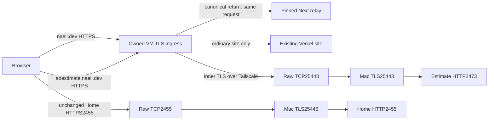

# A2 첫 단계 구체 설계 — 2026-10-19

**설계 후보를 하나로 좁혔다: 공개 Linux ingress 한 대, Mac의 TLS 전달 프로세스 한 개, 기존 Vercel·Estimate2473·Home2455 앱 유지다.** 먼저 `naeil.dev`와 `abestimate.naeil.dev`의 hostname 전체 수신 경계를 소유하고, Home의 주소는 그대로 둔 채 Tailscale Serve를 TLS 바이트 전달로 바꾼다. 새 private CA 대신 기존 `.ts.net` 서버 인증서와 정확한 Tailscale 접근 정책을 사용하는 조건부 안을 택했다. Jev는 첫 단계에 활성화하지 않는다.

이는 사용자의 “너가 지금 해야한다고 판단되면 진행해줘”에 따른 **구체 설계 완료**다. 운영 채택/적용 가능 판정은 보류한다. 현재 Hobby의 자체 프록시 지원 조건, 실제 host/접근 정책·인증서 보관 권한, Home의 기존 연결 종료와 앱 수집 통제가 아직 입증되지 않았다. 이전 [A2 검토](auth-a2-design-review-2026-10-19.md)의 미선정 항목에 아래 후보를 제시하며, 과거 관측을 소급 수정하지 않는다. 새 구현·격리 실행·구매·발급·DNS/tunnel·배포·프로세스·계정 적용은 이번 설계 허용에 포함하지 않았다.

## 이번에 새로 확인한 운영 metadata

| 읽기 전용 확인 | 결과와 한계 |
| --- | --- |
| 기존 Vercel project Overview와 Domains | 22:36 JST 현재 Hobby. `naeil.dev`는 Valid Configuration/Production, `design-system-red-five.vercel.app`도 Production 연결이다. 저장된 revision `ff37223`와 production deployment가 화면에 보였다. 기존 로그인 세션의 지정 두 페이지만 읽었고 생성한 탭은 닫았다. 실제 origin TLS/Host routing 검증은 아니다. |
| Mac 후보 포트 | 22:34 JST TCP25443·25445 각각 listener 없음. 대상 두 포트의 존재 여부만 보존했으며 예약하거나 bind하지 않았다. 적용 전 재확인이 필요하다. |
| 공개 DNS | 22:42 JST `naeil.dev` NS는 Cloudflare의 두 nameserver, CAA 응답 record는 없었다. 공개 recursive DNS 관측이며 zone API 권한·전체 발급 조건의 증거는 아니다. |
| Home baseline | 앞선 exact-target 영수증의 HTTPS Serve2455→loopback2455와 CLI/daemon1.102.2를 재사용한다. 이번에는 Serve·컨테이너·fixture·앱 요청을 다시 실행하지 않았다. |

안전한 필드와 시각은 [operating-metadata.json](evidence/auth-a2-stage1-design-2026-10-19/operating-metadata.json)에 보존했다. 광역 탭/자원 inventory, credential/env/private certificate 읽기는 없었다.

## 운영 대상과 연결을 고정한 후보

| 대상 | 선택한 설계 | 아직 생성/보증하지 않은 것 |
| --- | --- | --- |
| 공개 ingress | AWS Lightsail Tokyo(`ap-northeast-1`), Linux Small2GB/publicIPv4, 단일 인스턴스. 제안 이름 `naeil-auth-ingress-1`, static IPv4 하나, systemd의 비특권 서비스 한 개. 서비스는 공개80/443을 직접 받는다. | 실제 AWS account/resource ID, 이미지/binary hash, static IP, 결제·capacity·방화벽·독립 제어 권한. 이름은 신규 제안이며 기존 자원 발견 결과가 아니다. |
| 비용/크기 | 공식 bundle 기준 월US$12, 2vCPU/2GB/60GB/3TB. 첫 개인 수용을 위한 시작 크기이며 메모리·동시성 적격은 격리 artifact에서 확인한다. | 세금·초과 전송·별도 backup/추가 자원은 포함하지 않는다. inbound와 outbound가 quota를 소모하므로 proxy의 두 방향 전송을 고려한다. Vercel Enterprise 비용은 이 금액에 포함되지 않으며 전환을 선택하지 않았다. |
| 공개 DNS 범위 | `naeil.dev`, `abestimate.naeil.dev`만 새 staticIPv4로 향하는 DNS-only 수신. 실제 변경 전에 현재 A/AAAA/CNAME/proxy/redirect record와 버전을 고정한다. | 기존 다른 주소 계열/별칭을 남겨 우회 수신이 생기면 적격 아님. Jev DNS, 전역 nameserver, 메일 record, 일반 tunnel 항목을 바꾸지 않는다. |
| VM→Estimate | VM이 `jay-macmini-2.tail165003.ts.net:25443`에 내부 TLS로 접속. raw Serve25443→loopback25443의 Node TLS listener→기존 HTTP2473. TLS servername은 `.ts.net`, HTTP Host는 `abestimate.naeil.dev`. | VM node 신원과 유효 정책 전체가 해당 node만 Mac TCP25443에 접근시킴을 확인해야 한다. 공개25443/Funnel을 열지 않는다. |
| Home 브라우저 | 기존 `https://jay-macmini-2.tail165003.ts.net:2455` 유지. raw Serve2455→loopback TLS25445→기존 HTTP2455. | 현재 HTTPS mapping의 안전한 교체, certificate export/renewal 및 오래된 TLS 연결 종료는 미입증이다. Home 앱·DB·model gateway를 중지하는 설계가 아니다. |
| Mac 추가 프로세스 | 별도 감독되는 native Node 한 프로세스의 고정 loopback listener25443/25445. 동일 `.ts.net` pair를 Mac 안에서 재사용하고 두 context로 교체한다. HTTP를 재해석하지 않는 양방향 socket pipe다. | 임의 upstream·proxy 설정·새 CA·client key 배포·별도 DB를 만들지 않는다. Home WebSocket/stream과 현재 Auto/monitoring을 보존하는 검증은 필요하다. |

AWS의 [bundle](https://docs.aws.amazon.com/lightsail/latest/userguide/amazon-lightsail-bundles.html), [Tokyo 지원](https://docs.aws.amazon.com/lightsail/latest/userguide/understanding-regions-and-availability-zones-in-amazon-lightsail.html), [전송 quota](https://docs.aws.amazon.com/lightsail/latest/userguide/amazon-lightsail-faq-data-transfer-allowance.html), [staticIP 재할당](https://docs.aws.amazon.com/lightsail/latest/userguide/lightsail-create-static-ip.html)을 확인했다. 단일 VM 장애 시 두 공개 hostname의 가용성도 영향을 받는다. 첫 단계에는 load balancer/CDN/상시 standby를 추가하지 않고, 새 인증 시작 중단과 같은 정책의 artifact 복구를 택한다. 복구 시간 보장은 아직 없다.

## 공개 ingress와 Vercel origin 계약

첫 공개 TLS 종료점은 위 VM의 Node다. 앞에 HTTP를 해독하는 Cloudflare/CDN/LB를 두지 않는다. 제안 프로토콜은 HTTP/1.1만 광고하며 absent-ALPN은 H1으로 처리한다. H2 `:authority`를 Host로 만들어 기존 계약을 통과시키지 않는다. TLS/SNI·Host가 모호하거나 H1이 성립하지 않으면 데이터 없는 거부/연결 종료다. 이는 기존 앱 전부의 H1 동작을 수용 전에 검증해야 하는 새 ingress 조건이다.

1. 모든 TLS request/`clientError`/Expect/CONNECT/Upgrade 경로에서 저장 전 통제를 먼저 설치한다. 원문 origin-form target와 `rawHeaders`를 판정하기 전에 URL 생성·Next·upstream·오류 기록기를 호출하지 않는다. 보호 namespace의 반복 slash/backslash, dot/encoded-dot, 반복 percent, locale/Next-data/internal/absolute-form 변형은 인식 전용으로 처리하고 원문을 수정하지 않는다. 기존 `isServiceReturnPath`만 호출하면 반복 separator 누락이 생기므로 그것만으로 충분하다고 선언하지 않는다. 불명확한 보호 입력은 upstream으로 보내지 않는다.
2. `naeil.dev`의 단일 정확한 raw Host, GET, 정확한 `/auth/return/abestimate` 또는 `/auth/return/console`만 동일 request/response로 정상 Next16.1.7 `handle(req,res)`에 넘긴다. 세 번째 parsedUrl 인자·직접 API 호출·metadata 주입·standalone 개조는 없다. relay 전용 normal build, literal rewrite3개, 기존 parser/API를 유지하며 site proxy/i18n/별도 Auth 코드가 없다.
3. `/auth/return/jev`는 단계별 admission에서 보호 헤더를 가진 empty503으로 끝낸다. forwarding/nonce consumption/finalizer 호출이 없다. parser의 세 목적지와 향후 fixed303는 바꾸지 않는다. raw Host403, non-GET405+Allow, alias404, malformed400, 불충분한 own metadata503의 기존 의미를 유지한다. Node overflow431 등 앱보다 앞선 실패도 헤더와 query 비반사 조건을 검증하며, HTTP 응답이 성립하지 않는 TLS/parser 오류는 안전하게 닫는다.
4. 완전한 HTTP 거부/relay 응답에는 기존 `no-store`, `no-referrer`, `nosniff`, `DENY`, 고정 CSP를 사용한다. query/Location/body를 오류 로그에 넣지 않는다. valid callback은 실제 Next own data-string `initURL`이 원문 path/query를 담아야 한다. 이후 Next 내부의 `req.url` 정규화는 그 초기 metadata와 구별한다. strict parser, nonce/unknown-field 처리, 고정303/빈 fragment는 그대로다.
5. 일반 S 요청의 연결 대상은 **`design-system-red-five.vercel.app:443`**, TLS SNI/검증 이름과 HTTP Host는 **`naeil.dev`**로 고정한다. 따라서 canonical DNS를 다시 dial하지 않고 같은 production project로 연결하는 후보다. Node `https.request`의 분리된 hostname/servername/path 옵션을 사용하고 인증서 검증을 끄지 않는다. 이는 API상 가능한 구성이라는 추론이며, 현재 Vercel이 그 연결을 수용한다는 실행 증거는 없다. [Node HTTPS](https://nodejs.org/download/release/v22.22.0/docs/api/https.html#httpsrequestoptions-callback), [TLS 이름 검증](https://nodejs.org/download/release/v22.22.0/docs/api/tls.html#tlsconnectoptions-callback)
6. upstream에는 원문 path/query를 string으로 넘기고 body/response를 stream한다. 새 cache·redirect following·자동 retry가 없으며 Set-Cookie 복수값, status/Location, 쿠키, Origin, RSC/Server Action/form/upload 동작을 보존한다. hop-by-hop/Connection-nominated 헤더와 client가 위조한 forwarded/routing 헤더는 경계에서 제거하고, canonical Host/proto만 소유 설정에서 정한다. 실제 client-IP trust를 만들어내지 않는다. header ambiguity/smuggling과 잘못된 upstream framing은 고정 오류로 종료한다. 공개 S/E의 CONNECT는 금지하며, Upgrade는 확인된 제품 경로만 별도 허용한다. Home의 upgrade/stream은 raw pipe로 유지한다.
7. HTTP80에서는 callback/보호 alias를 HTTPS redirect에 싣지 않고 보호 거부한다. `naeil.dev`의 query 없는 엄격한 `/.well-known/acme-challenge/<token>` GET만 동일 명시 origin의80으로 보내 Vercel 인증서 validation을 유지한다. 다른 잘못된 입력은 거부하고 일반 비보호 navigation만 HTTPS로 전환한다. `/.well-known/vercel/*`는 HTTPS origin으로 전달하며 cache하지 않는다. VM 자체 certificate는 아래 DNS-01을 써서 challenge 소유권을 충돌시키지 않는다. [Vercel origin/validation 지침](https://vercel.com/kb/guide/can-i-use-a-proxy-on-top-of-my-vercel-deployment)

`src/app/auth/callback/route.ts`는 `request.url`의 origin과 Host로 redirect/cookie를 정한다. 따라서 origin을 `*.vercel.app`로 바꾸거나 나중에 임의 rewrite하는 안을 택하지 않았다. ordinary `/auth/callback`, invite, locale, ESG/Work, session·저장 보호는 기존 사이트 계약이며 relay를 그곳으로 보내지 않는다. 이번 범위의 OP01은 새 서비스 relay와 E/Home finalizer의 양 hop이다. 기존 Supabase 사이트 callback 자체의 새 보장까지 입증했다고 확대하지 않는다.

**Vercel 지원 조건은 실제 차단점으로 남긴다.** 현재 공식 문서상 Hobby/Pro는 지정 provider의 Lite, 자체 프록시 Advanced는 Enterprise 수동 등록 대상이다. 이 후보를 Registered/Verified라고 부르지 않는다. 현재 Hobby에서 기본 HTTPS proxy가 기술적으로 불가능하다는 결론도 아니다. 이 설계는 IP/위치 보존, proxy 차단 면제, reverse-proxy 지원 보장을 갖지 못한 조건부 연결이며 단일 요청 성공만으로 그 차이를 닫지 않는다. Enterprise 구매·문의나 다른 CDN 추가는 선택/실행하지 않았다. 지원 등록이 운영 필수이면 현재 플랜으로 채택 중단, 미등록 운영을 검토하려면 그 구체 가용성 책임에 대한 별도 결정과 제품 수용 증거가 필요하다. [공식 plan/등록 범위](https://vercel.com/docs/security/reverse-proxy)

## 인증서와 접근 권한의 최소 보관 절차

| 소유 단위 | 선택한 절차 | 발급/적용 전에 닫을 조건 |
| --- | --- | --- |
| 공개 두 hostname | 기존 Mac의 별도 owner 전용 certificate runner에서 Certbot+공식 Cloudflare DNS plugin을 사용해 두 hostname의 DNS-01 certificate를 발급/갱신하는 후보다. 공개 VM의 request process에는 DNS API token을 주지 않는다. 검증된 pair만 별도 승인된 비공개 전달로 VM의 versioned private store에 설치한다. | runner의 독립 실행/권한·private 보관/전달/복구 경로를 먼저 준비한다. 새 token은 `naeil.dev` zone DNS Edit로 제한하되 **TXT 두 record만의 권한으로 오인하지 않는다**. 현재 token을 찾거나 읽지 않았고 새 발급/등록도 하지 않았다. |
| 공개 renewal | 기존 Certbot renewal 판단/명령을 매일 실행하는 owner task, 성공한 SAN/chain/기간/key match 검증 뒤 atomic context 전환. 결과는 certificate fingerprint/expiry와 고정 상태만 남긴다. 실패 시 기존 유효 context 유지, 사전 만료 경고와 새 인증 admission 중단, 만료 시 fail-closed다. | 실제 client/plugin 버전, 부작용 없는 검증, public origin/Vercel certificate 갱신의 별도 성공 증거가 필요하다. HTTP 접속/개인키/진단 로그를 일반 증거에 포함하지 않는다. |
| Home/Estimate 내부 pair | 기존 node의 지원 `tailscale cert`로 정확한 `.ts.net` pair를 지정 private file로 발급, 매일 최소30일 유효기간을 요구한다. 검증 후 두 loopback context를 교체하며 private key는 Mac 밖으로 나가지 않는다. | GUI/CLI sandbox 변형과 PermitCert/PermitWrite·파일 출력 권한을 확인해야 한다. Serve가 자동 갱신한다고 export한 파일도 자동 설치되는 것은 아니다. 지원 경로가 없으면 정지하며 사용자의 key 제출이나 검증 해제를 요구하지 않는다. |
| 접근 정책 | 실제 새 VM identity→실제 Mac TCP25443 하나만 유효하도록 전체 matching grants/legacyACL/default/shared/routed access와 양 IP계열을 확인한다. 태그를 쓰면 단독 membership와 부여 권한까지 고정한다. | 좁은 grant 추가만으로 기존 광범위 허용이 사라지지 않는다. 기존 필요한 통신/독립 제어를 손상시키지 못하면 이 단순안은 미채택으로 남긴다. mTLS는 별도 준비/선택이 필요한 후순위 대안이다. |

기본 보관은 owner-only0700 directory/0600 private files, runtime에는 필요한 read만 허용한다. 공개 certificate fingerprint와 manifest는 일반 영수증, key/API credential과 복구 사본은 별도 private custody다. 무분별한 VM memory/disk dump 또는 business backup으로 묶지 않는다. 만료·교체·오류 판단은 credential/subject 객체를 출력하지 않는 전용 경로에서 수행한다. 현재 실제 비밀 위치나 권한이 확보됐다는 주장은 없다. [Certbot 공식 plugin](https://certbot-dns-cloudflare.readthedocs.io/en/stable/), [DNS-01 및 별도 발급 host](https://letsencrypt.org/docs/challenge-types/)

raw Serve 뒤 sidecar의 peer는127.0.0.1이므로 원래 VM을 식별할 수 없다. client 인증은 loopback 주소/헤더/WhoIs가 아니라 **그 앞에서 강제되는 Tailscale 정책**이다. 서버 인증과 payload 비노출은 내부 TLS가 담당한다. 실제 유효 정책으로 이 구분을 입증할 수 없으면 “TLS니까 안전”으로 통과시키지 않는다. [세부 채널·권한 설계](evidence/auth-a2-stage1-design-2026-10-19/home-channel.md)

## 저장 전 통제와 앱별 보존

OP01은 query/code/nonce, header, Location, 요청 유래 오류의 **영속 저장/내보내기 억제**다. 정상 처리 중 request buffer/Next metadata/오류 인자가 일시적으로 존재하는 것까지 금지하는 새 요구를 만들지 않는다. 최종 화면 redaction·retention 축소·export 필드 제외만으로 충족하지 않는다.

| 경계 | 구체적인 producer/저장 전 선택 |
| --- | --- |
| 새 VM relay | clean production bootstrap에서 Next import 전에 raw 인자를 무시하는 public Console subclass와 정적 event emitter를 설치한다. OTel SDK/provider/exporter·APM·diagnostic subscriber·DEBUG/NODE_DEBUG·instrumentation·`.env*`를 relay artifact에 넣지 않는다. public fatal/warning/report hook과 고정 startup allowlist를 사용한다. Node22.22 문서는 API 분석 기준이며 새 실행 binary의 실제 pin/지원 상태/해시는 구현 때 고정한다. |
| VM Node와 Linux host | request를 받기 전에 stderr는 null, stdout은 이미 데이터 없는 고정 event만, core/report/heap/keylog/trace와 지속 swap/memory snapshot은 비활성화한다. systemd의 stderr/core pipeline까지 묶는다. Console Writable에서 뒤늦게 지우면 앞선 diagnostics subscriber가 raw 인자를 볼 수 있으므로 충분하지 않다. ordinary transient memory를 비저장 위반으로 오인하지 않는다. |
| Estimate 앱 | 기존 dedicated Node24.21.0/standalone2473와 shutdown·writer/closed-gate 계약을 보존한다. 생성된 server.js 앞의 검토된 단일 public Node preload로 source-side logging 정책을 먼저 설치하는 후보다. relay의 즉시 fatal-exit 정책을 Estimate에 복사하지 않는다. `.env`/Auth 설정을 제거하는 relay-only 규칙 역시 제품 앱에 복사하지 않는다. 실제 packaged closure·수집기·launch의 증명이 필요하다. |
| Mac TLS pipe | request를 파싱/기록하지 않는 native TLS/socket pipe, 고정 upstream, TLS/접속 오류는 새 고정 category만 기록. TLS trace/keylog/core·payload dump·debug·무제한 diagnostic buffer·자동 재시도가 없다. raw Serve는 정상적으로 ciphertext만 다루지만 flow metadata가 사라진다는 뜻은 아니다. **Mac launchd의 native stderr/core/crash report 저장 전 통제는 아직 입증되지 않은 채택 조건**이며 Linux 설정을 그대로 적용했다고 간주하지 않는다. |
| Home 앱 | 현재 e618 ancestry/26-revision/Auto·monitoring을 보존하는 새 scoped OpenSpec에서 Console auth 경계만 이식한다. Uvicorn `access_log=False`로 access record 생성을 없애고, auth의 예상/예상 밖 실패와 protocol 오류·모든 handler/queue/exporter가 request-bearing record를 저장하기 전에 고정 record만 받도록 한다. root-logger filter 하나나 formatter만으로 전체 전파 경계를 닫지 않는다. 기존 Auto/monitoring의 일반 동작/필요 로그를 보존한다. |

검토 가능한 정확한 API·소스·순서와 한계는 [relay-controls.md](evidence/auth-a2-stage1-design-2026-10-19/relay-controls.md), Home/Tailscale 경계는 [home-channel.md](evidence/auth-a2-stage1-design-2026-10-19/home-channel.md)에 있다. 기본 새 event 보관은 owner-only30일의 정적 component/event/version·집계 count·인증서 만료 상태로 한정한다. per-request URL, query hash, 임의 error text, header, Location, request ID는 만들지 않는다. 보관 삭제나 기존 로그 청소는 이번 작업이 아니다.

## 전환·복구 순서와 명시적 중단점

1. **격리 구현 전 준비:** 위 설계의 파일/범위와 체크를 묶고, 실제 binary/패키지·source hash와 수집기 목록을 고정한다. 이미 끝난178/fixture suite를 다시 수행하지 않는다. 현재 Home 이식·Estimate closed gate·중앙 private runner/recovery의 별도 미완료 조건도 유지한다.
2. **각 운영 적용 전:** owner가 당시 writer·모든 data/backup/auth/config 및 DNS/tunnel/Serve version·artifact/launch·현재 인증서 보관을 새로 보존한다. exact 대상·diff·적용 순서·중단/복구 artifact를 완성한 뒤 각 적용만 승인받는다. 이 문서의 제안 resource 이름/포트는 생성/정지 권한이 아니다.
3. **독립 제어:** Mac 로컬 owner 제어와 VM 별도 관리 경로가 Home2455/새 ingress 장애에도 작동함을 먼저 증명한다. 에이전트가 현재 응답한다는 사실, 새 VM의 이름 또는 Home gateway를 통과하는 제어는 그 증거가 아니다.
4. **Home 같은 포트 전환:** 새 TLS pipe/certificate/앱 producer 통제를 준비한 뒤 신규 auth 시작을 막고 기존 시도를 소진/만료시킨다. 기존 model·monitoring WebSocket/stream도 강제종료 없이 정리되는지 확인한다. 정확한 HTTPS2455 mapping만 off→raw TCP2455 on으로 바꾸는 지원 경로는 비원자적이며 새 연결 공백이 있다. `serve drain`은 이 로컬 port의 drain 증거가 아니다. 기존 daemon-terminated TLS 연결의 잔존을 payload 없이 판정할 수 없으면 전환 중단이다. Home/daemon restart, kill, global reset으로 해결하지 않는다.
5. **두 공개 hostname 전환:** 새 certificate와 모든 ingress/app 수집 통제를 갖춘 후 exact DNS 항목만 변경한다. 구 DNS/keepalive 경로와 진행 중 auth를 함께 다룬다. TTL 대기만으로 구 경계 비도달을 주장하지 않는다. 첫 수용은 통제된 Jay client의 resolver/연결 경로와 구 연결 폐기를 확인한 뒤 시작한다. 임의 client 전체에 대한 general-release 적격은 별도이며, 기존 미해결 경계로 callback이 갈 수 있으면 새 로그인 시작을 열지 않는다.
6. **새 auth 활성화 전 장애:** 별도 승인한 구 mapping 복귀는 relay 의존 auth가 계속 꺼진 ordinary-service 복구에만 쓸 수 있다. **활성화 후 장애:** 동일 수집/authority 정책의 이전 안전 artifact·sidecar·staticIP 재할당/forward fix 또는 신규 시도 중단이다. 구 Vercel/Cloudflare/Tailscale-HTTP query 경계로 되돌리는 것을 인증 rollback으로 부르지 않는다. 현재 세션·중앙 정책과 참조된 relay/finalizer는 유지한다.
7. **나머지 수용:** relay canonical 적격→schema/기존 Jay→Home 개인 관리자→Estimate 실제 연결→별도 verified→Estimate 명시 grant→실HTTPS 수용 순서다. 실제 로컬 Auth/DB 허용 경로와 실제 연결의 미허용 개인 JWT403을 분리한다. Jev/새 초대/실메일은 뒤이며 기존 언어·단일 관리자·명시 권한표와 자동SSO/전역logout/언어동기화/견적번역 금지를 유지한다.

## 다음에 승인할 수 있는 유한 구현 단위

**첫 구현 단위는 돈/DNS/계정 없이 끝나는 relay·TLS pipe의 격리 후보다.** 새 isolated 작업 영역에 normal Next relay, public Node bootstrap/early guard, 고정 proxy/pipe만 만들고 synthetic certificate/로컬 mock upstream을 사용한다. 제품 S/E/H dirty 원본, 실제 Auth/DB/secret/fixture, 운영 listener에는 연결하지 않는다. 실제 인증서/DNS/서버를 먼저 구매해서 설계를 시험하지 않는다. 이 단위는 이번에 실행하지 않았다.

| 한 번의 검증군 | 선택을 바꾸는 실패 조건 |
| --- | --- |
| 실제 Next dispatch | 세 literal route의 success/error6개와 기존 raw-query 구분, own metadata·raw Host·fixed303/empty fragment. public stage1의 Jev는 별도 dormant503이며 production admission을 우회하지 않는다. metadata 제조·손실·허용 확대가 있으면 후보 폐기/수정. |
| 조기 응답/일반 proxy | alias·method·Expect/CONNECT/Upgrade·parser overflow·H1/TLS·forged authority, plain HTTP 보호 경로. mock Vercel로 보호 query가 한 번도 전달되지 않고 complete header/no reflection을 입증. ordinary cookies/RSC/forms/stream/body framing·forwarded header 정책 회귀. |
| 저장 경계 | custom inspect/getter/console diagnostics, Next/API throw, TLS/socket/JS/native fatal을 disposable child에서만 검증. producer/config closure와 저장 sink를 함께 검사. marker 검색만으로 보장하지 않는다. |
| private channel | mock raw TCP 중계에서 내부 TLS가 유지되고 Home WebSocket/stream bytes, certificate context 교체/만료 실패와 고정 upstream이 보존되는지 검증. 실제 tailnet grant·Serve 교체·cert export 권한은 이 격리 성공으로 대체하지 않는다. |

그 다음 실제 Vercel origin/지원 조건, Tailscale 유효 권한/인증서 출력·독립 제어/연결 종료, E/Home의 현재-source logging/보존 candidate를 exact 적용 묶음으로 준비한다. 이 실패 조건을 바꾸지 않는 새 hosted observer, provider 문의/사람 답변 대기, 이전178 재실행은 추가하지 않는다. 기술적으로 가능한 후보와 현재 운영 적격을 계속 구분한다.

## 산출물과 검증

메인은 운영 대상/Vercel/인증서·전환을 통합했고, 독립 담당2명이 logging bootstrap과 private channel을 범위별로 검토했다. 채널의 불필요한 private CA를 제거했으며, Estimate의 전용 runtime/종료 계약을 새 relay 정책과 분리했다. 문서·dependency/source hash·5cwd HEAD/status·보호71개·local link·공백 검증 및 별도 통합 검토 결과는 [verification.json](evidence/auth-a2-stage1-design-2026-10-19/verification.json)에 기록한다.

이번 결과는 설계·읽기 전용 metadata다. 앱 코드/기존 설정·DB·인증서·DNS·프로세스를 변경하지 않았고 build/test/app probe/계정/provider/메일/commit/push/배포는 실행하지 않았다. UI0.7.1 운영과 새 인증 전환은 별개이며 실제 계정/HTTPS 수용과 Production 적격은 미완료다.
