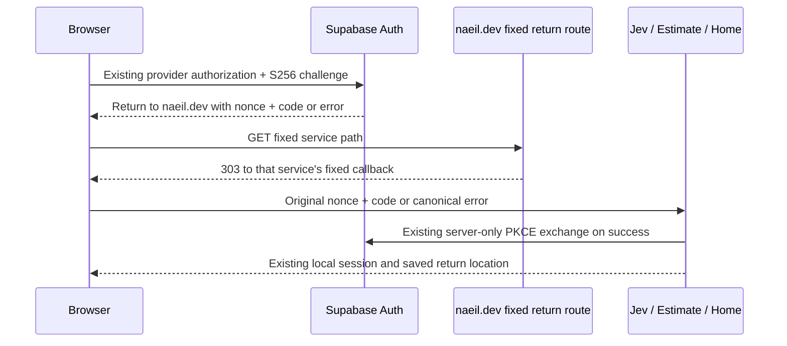

# Exact OAuth return transport — decision proposal, 2026-10-18

Status: **proposed, not approved or implemented**. This is a concrete design decision for the newly found callback compatibility blocker. Existing local invitation/Home reconciliation work remains complete for its recorded scope. No hosted settings, account/grant, email, process, push or deployment change is authorized by this document.

## Intent and observed incompatibility

Preserve current hosting, UI0.7.1, per-service personal sessions and the approved nonce/cookie/S256 PKCE/error-cancellation contract while making real provider returns work with the current Supabase Auth project. Do not add wildcard callbacks, SSO, global logout, shared session cookies, automatic identity linking or new service authority.

The read-only hosted health observation reports GoTrue v2.197.0. Its pinned public validator compares other-origin redirect URLs **including their query** against the allowlist, removing only the fragment. E/J/Home currently submit changing `?nonce=...`, so adding three static callback URLs is insufficient. The same SiteURL origin, `https://naeil.dev`, is accepted with its query under the pinned implementation.

Moving the nonce to a fragment is insufficient too: the PKCE success helper preserves it, but GoTrue replaces the fragment on provider errors. E/J currently consume the matching bound attempt on cancellation; fragment-only error handling loses that correlation. A cookie-selected latest attempt or automatic browser-storage fallback changes which attempt is consumed. Preserve the current finalizers rather than silently weakening this behavior. Evidence: [callback finding](../../rollout/evidence/auth-transition-preparation-2026-10-18/callback-compatibility.json) and [independent review](../../rollout/evidence/auth-transition-preparation-2026-10-18/callback-compatibility-review.md).

## Recommended choice: fixed server return routes

Each service keeps generating/storing its own random nonce, verifier, S256 challenge, cookie binding, deadline and allowed return location. Only its `redirect_to` transport changes to the matching fixed naeil.dev route with the original nonce in the query. GoTrue therefore retains that nonce on both success and error.

| Service | Proposed redirect_to base | Only permitted final callback |
| --- | --- | --- |
| Jev | `https://naeil.dev/auth/return/jev` | `https://jev.naeil.dev/auth/callback` |
| AB Estimate | `https://naeil.dev/auth/return/abestimate` | `https://abestimate.naeil.dev/auth/callback` |
| Home Console | `https://naeil.dev/auth/return/console` | `https://jay-macmini-2.tail165003.ts.net:2455/api/console/auth/callback` |

The Home destination is the currently observed2455 ingress, proposed for this design. Before operational activation it must equal the actual configured Console origin, including port. No DNS/tunnel change is proposed. Production destinations are server-owned exact constants, not request/query/Host/forwarded-header inputs. Local transport tests may inject a fixed loopback mapping into a pure handler factory; no product token-import route or runtime test-enabling flag is introduced.

The naeil.dev handler never exchanges a code, calls Auth/DB, creates or reads an auth transaction, reads site cookies for authority, sets/deletes cookies, chooses an identity or grants access. Only the final service has its verifier and verifies its original browser binding. It can reject a forwarded request independently. A request cannot select an arbitrary destination or carry a new returnTo.

## Transport contract to implement after the decision

- Three exact canonical routes only; unknown services/extra path segments fail closed. Use GET303 with a fixed destination and a fresh encoded query, never a permanent redirect. Explicit HEAD and all other method handlers return405 without Location, with `Allow: GET` and no-store/no-referrer; do not let Next synthesize HEAD from GET and forward it to a consuming finalizer. The handler does no network or persistent work.
- Every successful relay303 explicitly clears the fragment in Location (an empty `#` component), preventing browser inheritance of GoTrue error fragments or an attacker-appended fragment. It never copies a fragment into the destination. Verify the actual browser redirect behavior, not only server query parsing.
- Parse in this order: raw query UTF-8 byte length at most16KiB; strict form decoding exactly once; decoded nonce multiplicity and shape; then remaining query classification. Invalid percent/UTF-8 encoding or excessive size returns generic400 before selecting any attempt. Split raw pairs before decoding so encoded value delimiters cannot become new fields. Ordinary percent-encoding inside GoTrue values is allowed.
- Exactly one nonce with the raw key `nonce` and a decoded43-character base64url value is required. Count decoded key aliases before testing the raw name: `%6eonce=N&nonce=M` is duplicate and selects neither attempt. Missing/duplicate/malformed nonce, or an encoded nonce key, produces400 without redirect.
- Success is exactly nonce plus one nonempty code, maximum4096 characters, with no error/token/unknown keys. Forward only those two encoded values. Never accept access_token, refresh_token, verifier, destination, host, service or returnTo authority in the query.
- The pinned error shape is nonce + error, with optional error_description/error_code. Bound each error value to4096 characters and the complete query to16KiB; neither log nor render them. Forward only the nonce and the fixed `error=authentication_failed`, so the original finalizer retires that exact attempt without exchanging a code. No supplied error text becomes UI or redirect data.
- After a unique canonical nonce is established, controls in other decoded keys/values, noncanonical encoded keys, duplicate/unknown/token keys, missing/empty/overlong code, malformed error fields or mixed success/error inputs produce the same canonical failure. Never partially sanitize such input into success, forward token/unknown fields, guess a nonce or create a transaction. The size/decoding/nonce400 boundaries above do not retire an attempt and are not claimed to reproduce every existing malformed-input side effect.
- All supported responses carry `Cache-Control: no-store`, `Referrer-Policy: no-referrer`, `X-Content-Type-Options: nosniff`, `X-Frame-Options: DENY` and a data-free CSP (`default-src 'none'; base-uri 'none'; form-action 'none'; frame-ancestors 'none'; object-src 'none'`). No HTML script, app shell, locale middleware, analytics or external subresource is required.
- Reject forged/unexpected raw Host against the configured site authority. Next's internal request URL origin and forwarded headers are not authority. Explicitly cover trailing-slash/canonicalization and Next aliases so a framework308 cannot cache or expose the query under weaker headers. Next16 pre-dispatch TRACE500 remains a separately recorded ingress gate.
- Complete query/authorization URLs must be suppressed in app errors, tracing and actual ingress/platform logs on both site and service hops. App source and response headers alone do not prove platform log redaction. If the selected hosting path cannot meet this existing query-secrecy contract, stop operational activation and review that concrete limitation.
- Do not modify existing site `/auth/callback`, `/auth/invite`, SSR generation/epoch cookies, ESG/Work callbacks, language routing or consumer saved-return validation. E remains Japanese-only; J/site remain ko/ja/en. No shared UI change.

## Affected sources and preserved boundaries

| Owner | Proposed scoped files | Preserve |
| --- | --- | --- |
| Site | new `src/lib/auth/service-return.ts`, `src/app/auth/return/[service]/route.ts`, focused tests; explicit return-route handling in `src/proxy.ts`/`next.config.ts` only as required for effective headers/canonicalization | Existing site auth/invitation source, UI package, business/public content and existing callbacks |
| Estimate | `src/server/naeil-auth-client.ts`, callers only if signature changes, focused authorization/HTTP tests and access contract addendum | JSON store/writer, nonce consumption/finalizer, tokens, expiry, saved return, all business/save guards |
| Jev | `src/server/naeil-auth-client.ts`, callers only if needed, focused authorization/HTTP tests and access contract addendum | SQLite/quota/stream, finalizer, local logout, language/input/result guards |
| Home | `app/modules/console/api.py` authorization URL only, relevant tests and a new OpenSpec change before code | Home/personal/Host gates, sessions, admin checks, SMTP/invitations, reconciled production overlay |

Home currently clears its current transaction before validating a stale/missing nonce. A stale callback can therefore invalidate a newer pending attempt; E/J do not do this. The relay does not claim to fix or worsen that pre-existing behavior. Record a regression boundary explicitly; changing Home's transaction selection would be a separate scoped change. The proposed relay adds no cookie-selected fallback.

## Verification and delegation boundary

After the design decision, use failing tests first. Independent implementation tasks can own site relay, E/J generators and Home generator/OpenSpec separately, with one independent security review and root integration verification. Preserve all old immutable artifacts; any changed source needs a new artifact identity.

1. Pin/hash the actual-version validator, glob configuration, success constructor and error constructor. Show both code and cancellation retain query nonce through the selected route, while old other-origin static callbacks fail. Clearly distinguish upstream source/local execution from actual hosted OAuth.
2. Test the relay through real built HTTP for success/error, valid-nonce malformed cases, duplicates, controls/encoding, oversized inputs, unknown services/paths, methods/aliases/forged Host, fixed destinations and explicit fragment clearing, zero cookies/Auth/DB calls and effective headers. HEAD must not redirect. No arbitrary redirect or query reflection.
3. Cross actual local redirect transport and existing finalizers with fictional identities. Check cookie mismatch, swapped nonce/code, replay, duplicate finalizers, expiry/restart, logout between hops/during exchange, start-B/old-A behavior, cancellation then attempted reuse, saved return/language and existing site/invite/ESG/Work routing. Test clients that bypass upstream redirect validation are insufficient by themselves.
4. Browser checks must follow the actual303 chain; JavaScript disabled should still work. Verify Lax cookie behavior across both hops and preserve existing editing-tab/new-tab recovery. Real HTTPS/provider account choice and live ingress logs remain separately authorized operational checks.
5. Rebuild affected candidates in isolated roots, verify exact source/archive/UI0.7.1 identities, keep original receipts, and update operational order and recovery references. Existing public-config site build is a baseline candidate, not evidence for an unimplemented relay.

## Added dependency, rollout and recovery

The extra hop exposes the short-lived code and nonce to naeil.dev's request path and makes new service login depend on that site's return endpoint. PKCE verifiers/access/refresh tokens remain at the service, but the extra processing/logging surface is a real trust change. Existing sessions continue to use their service and Supabase directly; the relay does not refresh or share them.

Only after local validation and separate operational approval: prepare a new immutable Vercel artifact with verified logging/headers, deploy and verify the inert relay before activating consumers that reference it, then transition one service at a time using fresh writer and preservation evidence. Keep the return routes available while any active consumer generates them and until all remaining attempts have expired; an older site artifact without these routes is not a compatible rollback. Keep SiteURL and existing three callbacks unchanged; the proposed relay itself needs no new wildcard or three cross-origin allowlist entries under the pinned same-SiteURL rule. A managed override/version difference must be checked with approved actual OAuth before marking a service connected.

Failure of the relay fails new login closed. Recover the exact route with a reviewed artifact or forward fix; do not redirect to password-only auth, share site sessions, silently switch nonce transport, reset data or restore old backups. In-flight attempts retain their original lifetime and may require a fresh user-initiated login after expiry.

## Decision requested

Approve **local implementation and isolated validation of these fixed naeil.dev return routes**, including the extra code-bearing hop and the narrow generator changes, or choose a different reviewed architecture. This decision would not approve schema/settings, actual membership/grants, real mail, push/merge/deployment or production process changes. The smaller fragment-only alternative would require an explicitly changed cancellation/recovery contract; it is not proposed as equivalent.
